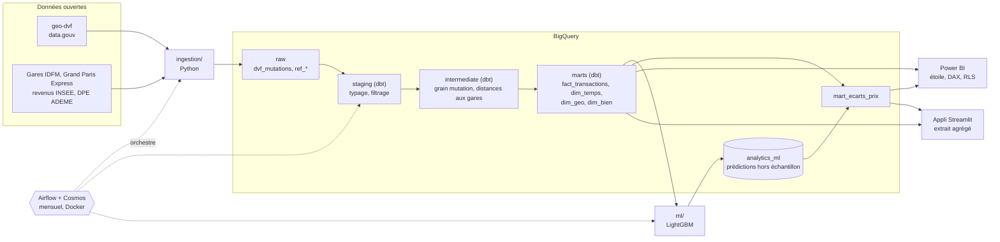

# DVF Analytics — Plateforme analytics immobilière de bout en bout

*English version: [README.en.md](README.en.md)*

Plateforme analytics sur les transactions immobilières françaises publiques (DVF
géolocalisé), construite comme un projet portfolio data : chaîne complète de
l'ingestion cloud à la restitution BI, avec une brique data science et une brique
qualité de données.

Enrichissement par données ouvertes : gares IDFM et futures gares du Grand Paris
Express (distances calculées dans BigQuery), revenus INSEE, diagnostics énergétiques
ADEME (voir `docs/enrichissement.md`).

Périmètre : Île-de-France (départements 75, 77, 78, 91, 92, 93, 94, 95), années
publiées dans geo-dvf (fenêtre glissante d'environ 5 ans, lue sur data.gouv à
chaque exécution). Scalable au national une fois la chaîne stabilisée.

**Appli publique (carte des prix, fourchettes, effet gare, écarts au modèle) :** https://dvf-analytics.streamlit.app/

**Documentation dbt (lignage, descriptions, tests) :** https://gabrielgnrx.github.io/dvf-analytics/

## Architecture

## Couches et compétences démontrées

| Couche | Dossier | Compétence ciblée |
|---|---|---|
| Ingestion | `ingestion/` | Pipeline data, cloud warehouse, rafraîchissement incrémental des fichiers |
| Enrichissement | `ingestion/enrichment.py` + `stg_ref__*` | Croisement de sources ouvertes (IDFM, INSEE, ADEME), géospatial BigQuery |
| Transformation | `dbt/dvf/models/` | Analytics engineering (dbt, schéma étoile, exposures, fraîcheur des sources) |
| Qualité | tests dbt + `exploration/` + `tests/` | Gouvernance, data quality, tests unitaires |
| Data science | `ml/` | Modélisation, validation temporelle, prédictions hors échantillon, régression hédonique |
| BI | `bi/` + Power BI | Modélisation dimensionnelle, DAX, RLS |
| Orchestration | `airflow/` | Airflow + Cosmos, Docker, contrôle qualité bloquant |
| Restitution publique | `app/` | Appli Streamlit sur extrait agrégé |
| Industrialisation | `.github/workflows/` | CI (ruff, pytest, dbt parse), documentation publiée sur GitHub Pages |

## Démarrage rapide

1. Prérequis : Python 3.10+, un projet GCP avec BigQuery activé, Cloud Shell ou `gcloud auth application-default login` (OAuth, sans clé).
2. `python -m venv .venv && source .venv/bin/activate`
3. `pip install -r requirements.txt`
4. Copier `.env.example` vers `.env` et le remplir.
5. Ingestion : `python -m ingestion.load_to_bq` puis `python -m ingestion.enrichment`
6. dbt : `cd dbt/dvf && dbt debug && dbt build`, puis `dbt source freshness`
7. Modèle : `python -m ml.train_prix_m2`, puis `dbt build --select mart_ecarts_prix`
8. Effet gare à commune égale : `python -m ml.effet_gare`
9. Appli : `python -m app.export_extrait` puis `streamlit run app/streamlit_app.py`

Développement : `pip install -r requirements-dev.txt`, `pre-commit install`,
`pytest`. Détail dans `SETUP.md`, orchestration dans `airflow/README.md`.

## Avancement

- [x] Semaine 1 — Socle : ingestion + raw dans BigQuery + dbt connecté + profilage
- [x] Semaine 2 — Transformation : staging + intermediate + schéma étoile + tests (premier jet)
- [x] Semaine 3 — Data science : modèle prix au m², méthodo, analyse d'erreur (voir `docs/resultats_modele.md`)
- [x] Semaine 4 — BI : modèle sémantique Power BI (import, étoile, 21 mesures DAX, 3 rôles RLS), rapport 5 pages (`bi/DVF_Analytics.pbip`)
- [x] Semaine 5 — Gouvernance : lignage, règles, tests, indicateurs qualité, RLS (`docs/gouvernance_qualite.md`)
- [x] Orchestration : pipeline mensuel Airflow (Docker + Cosmos), voir `airflow/README.md`
- [x] Enrichissement : gares et Grand Paris Express (IDFM), revenus (INSEE), DPE (ADEME), page Power BI « Transports et contexte local » (`docs/enrichissement.md`)
- [x] Industrialisation : tests unitaires, CI, documentation dbt en ligne, exposures, fraîcheur des sources
- [x] Écarts au marché calculés hors échantillon ; effet gare estimé à commune égale
- [x] Appli publique Streamlit (`app/`)

## Premiers résultats (run du 17 novembre 2026, geo-dvf 2021 à 2025)

- 2,43 M lignes brutes chargées, agrégées en environ 885 000 mutations (ventes).
- Une mutation DVF est éclatée sur plusieurs lignes et la valeur foncière y est
  répétée : la couche `int_dvf__mutations` ramène au grain mutation avant tout
  calcul de prix au m².
- Prix au m² calculé uniquement sur les ventes d'un seul logement, avec un
  indicateur `est_prix_m2_fiable` (bornes 1 000 à 30 000 €/m²) plutôt qu'une
  suppression silencieuse des valeurs aberrantes.
- Contrôle de cohérence : prix médian au m² de 10 325 € à Paris, 6 900 € dans
  les Hauts-de-Seine, 3 136 € en Seine-et-Marne.
- `dbt build` : 66 nœuds (modèles, seed, tests de schéma, relations fait / dimensions, plages de valeurs, couverture de l'enrichissement), 0 erreur, 1 avertissement documenté.
- Modèle LightGBM, test sur 2025 jamais vue : erreur médiane 13,0 % contre 16,3 % pour la baseline médiane commune x type (R² log 0,80).
- Écarts au marché calculés hors échantillon (chaque vente prédite par un modèle qui ne l'a pas vue) : erreur médiane 12,2 %, 42 % des ventes à ±10 % du prix attendu.
- Enrichissement : en petite couronne, un appartement à moins de 500 m d'une gare
  se vend environ 80 % plus cher au m² qu'à plus de 2 km ; à commune égale
  (régression à effet fixe, `ml/effet_gare.py`), la prime tombe à environ 23 %
  (intervalle de confiance à 95 % : 7 à 41 %), le reste de l'écart venant de la
  localisation des communes ; pas de prime « Grand Paris Express » visible entre 2021 et
  2025 ; le modèle enrichi passe à 12,8 % d'erreur médiane (voir `docs/enrichissement.md`).

## Licence

Code sous licence MIT (`LICENSE`). Les données restent sous les licences de
leurs producteurs (DGFiP via data.gouv, Île-de-France Mobilités, INSEE, ADEME).
